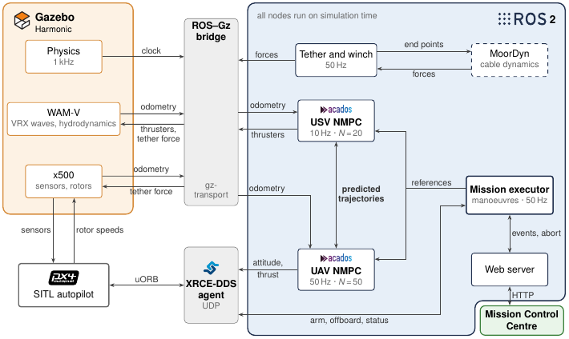
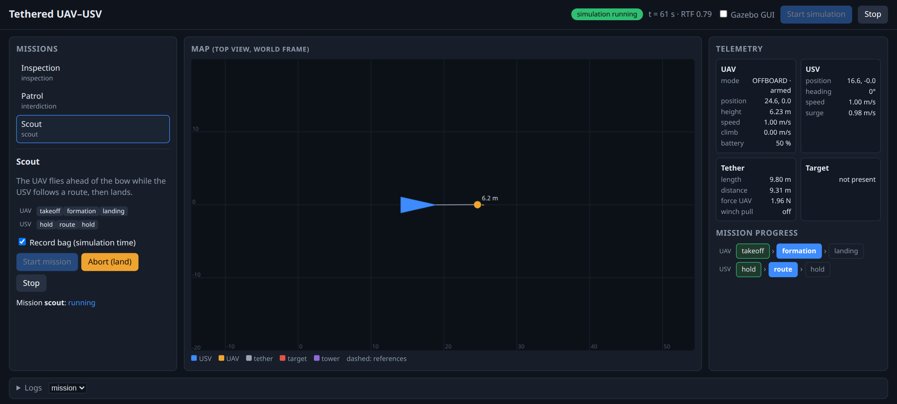

# Tethered USV–UAV Cooperative NMPC

Cooperative nonlinear model predictive control of an unmanned surface vehicle (USV) and an unmanned aerial vehicle (UAV) connected by a tether, in ROS 2. The USV is a WAM-V catamaran and the UAV an x500 multirotor; the system is simulated at sea with Gazebo, PX4 and MoorDyn.

This repository holds the code of the MSc thesis *Cooperative control of a tethered drone and surface vessel for sustained presence at sea* (Tomás Grossinho Esteves, MSc in Electrical and Computer Engineering, Instituto Superior Técnico, 2026).

- **One NMPC per vehicle** (acados): each plans its own motion within its limits, over its own horizon (USV: 2 s at 10 Hz; UAV: 1 s at 50 Hz).
- **Cooperation through predicted trajectories**: the two controllers exchange the trajectories they predict, so that each keeps the tether within its reach knowing where the other vehicle is going.
- **Tether force model**: a closed-form model of the force of a slack tether, with its weight, used in the prediction of the UAV.
- **Disturbance observer** in the UAV NMPC, which compensates forces the model does not describe, such as wind.
- **Simulation**: VRX waves and hydrodynamics, PX4 SITL, and a lumped-mass tether in MoorDyn whose length is set by a geometric winch.
- **Missions**: manoeuvres (takeoff and landing on the moving deck, formation, orbit, follow) chained into missions, run from a web Mission Control Centre.



## Packages

| Package | Description |
|---|---|
| `control/usv_mpc` | NMPC of the WAM-V: thrusts and azimuths as states, their rates as inputs, tether constraint from the predicted UAV trajectory |
| `control/uav_mpc` | NMPC of the x500: attitude and thrust commands to PX4, tether force model, separation and winch-rate constraints, disturbance observer |
| `mission/mission_maneuvers` | Manoeuvres of both vehicles, which give the reference of each NMPC over its horizon |
| `mission/mission_executor` | Runs a mission: one sequence of manoeuvres per vehicle, chained by events (missions in `missions/`) |
| `simulation/moordyn_tether` | Tether simulated in MoorDyn and coupled to Gazebo, with the geometric winch (L = d / (1 − ε₀)) |
| `simulation/description` | Gazebo models of the WAM-V (with landing pad), the x500 and the target vessel |
| `simulation/gazebo` | World at sea |
| `simulation/intruder_sim` | Moving target of the patrol mission |
| `estimation/frame_manager` | TF frames of both vehicles and of the tether anchor |
| `estimation/mocap_bridge` | Ground-truth odometry of the UAV fed to PX4 as external vision |
| `bringup` | Launch of the whole simulation |
| `web_dashboard` | Mission Control Centre (http://localhost:8080) |
| `external/` | VRX (submodule), `px4_msgs`, and vendor packages of MoorDyn and of the Micro XRCE-DDS Agent |

## Requirements

Tested with:

- Ubuntu 24.04, ROS 2 Jazzy, Gazebo Harmonic (gz-sim 8)
- PX4-Autopilot v1.16.1, built for SITL (`make px4_sitl`)
- acados v0.5.x, with `ACADOS_SOURCE_DIR` pointing to its installation
- `ros-jazzy-ros-gz`, `ros-jazzy-foxglove-bridge`, Eigen, yaml-cpp

The solvers generated by acados are included, so Python is only needed to regenerate them (see below).

## Build

```bash
mkdir -p ~/tethered_ws/src && cd ~/tethered_ws/src
git clone --recurse-submodules https://github.com/tomasgesteves1/tethered-usv-uav-nmpc.git
cd ~/tethered_ws
source /opt/ros/jazzy/setup.bash
export ACADOS_SOURCE_DIR=~/acados
export LD_LIBRARY_PATH=$LD_LIBRARY_PATH:$ACADOS_SOURCE_DIR/lib
colcon build --cmake-args -DCMAKE_BUILD_TYPE=Release
```

The launch expects PX4 in `~/PX4-Autopilot`; otherwise set `PX4_DIR`.

## Run

From the Mission Control Centre:

```bash
source ~/tethered_ws/install/setup.bash
ros2 launch web_dashboard dashboard.launch.py
```

and open http://localhost:8080, where the simulation is started and a mission chosen.



Or from the command line, in two terminals:

```bash
ros2 launch bringup simulation.launch.py              # Gazebo, PX4, bridges and tether (headless:=true without GUI)
ros2 launch mission_executor mission.launch.py mission:=scout
```

| Mission | Description | Options |
|---|---|---|
| `scout` | The UAV flies ahead of the bow while the USV follows a route | |
| `inspection` | The UAV circles a tower at three heights while the USV supports it from the water | `tether_max_length:=45.0` |
| `wait` | The USV waits at the reach of the tether for a UAV that cannot follow it, then collects it | `tether_max_length:=20.0` |
| `interdiction` | Patrol: the UAV orbits the USV until it detects a moving target, which both then follow | `intruder:=true tether_max_length:=20.0` |
| `landing_demo` | Takeoff, move away and land back on the moving deck | |
| `showcase` | All the basic manoeuvres in one mission | |

The disturbance observer can be turned off with `disturbance_observer:=false`.

## Regenerating the solvers

The models, costs and constraints are written in CasADi and exported to C by acados. After changing them, or the parameters they read (`config/uav_mpc.yaml` for the UAV, `config/acados_generator_config.json` for the USV), regenerate the solver and rebuild:

```bash
pip install -e $ACADOS_SOURCE_DIR/interfaces/acados_template
(cd control/uav_mpc/scripts && python3 generate_acados_uav.py)
(cd control/usv_mpc/scripts && python3 generate_acados_usv.py)
```

## License

Apache License 2.0, see [LICENSE](LICENSE). VRX and `px4_msgs` keep their own licenses.
